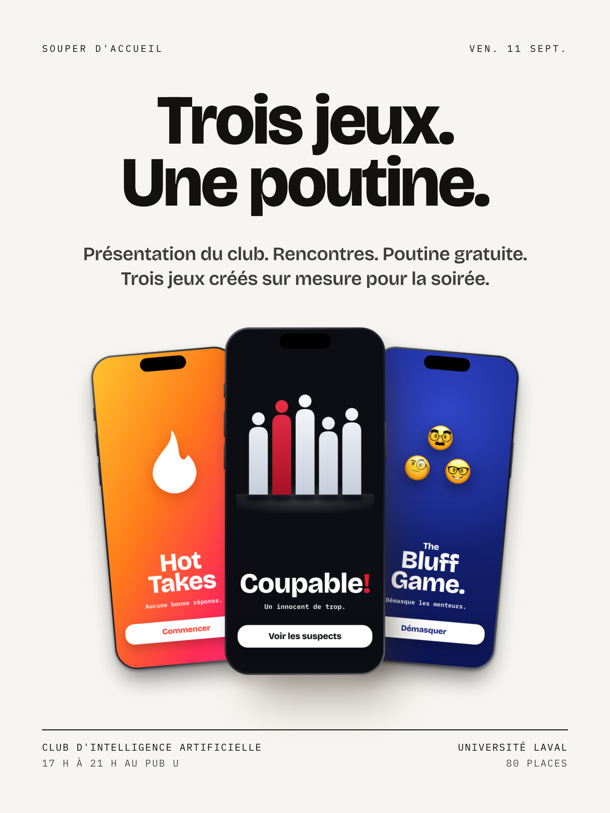
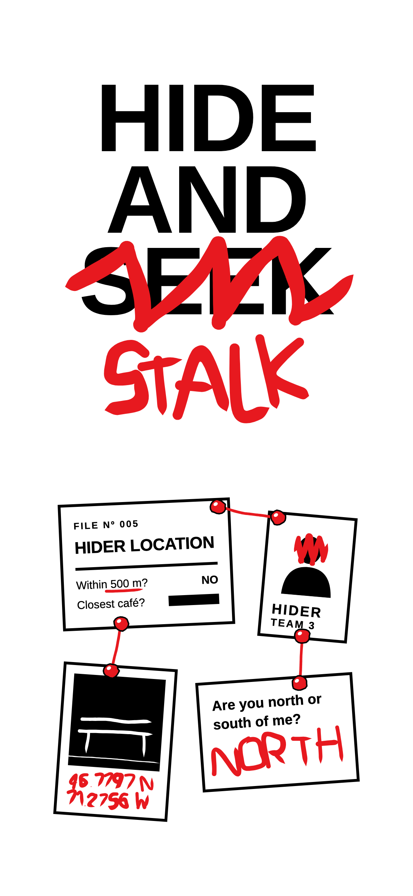
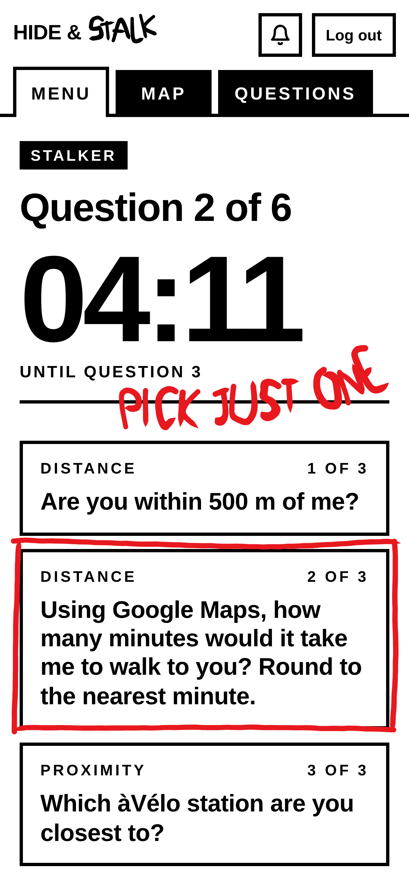
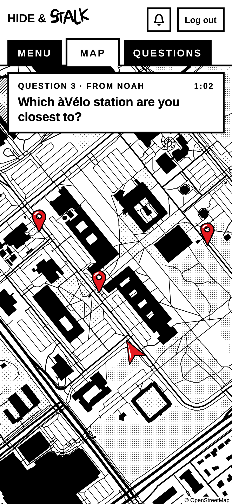

Chaque page du site est un fichier Markdown, avec ses images à côté. Voici chaque élément, suivi du Markdown qui le produit.

## La photo

La propriété `photo` met une image au-dessus du titre, coupée en carré, comme l'icône d'une page Notion. C'est aussi l'image de la page quand on partage son lien. Une page sans `photo` n'en montre pas.

```md
---
photo: ./images/ulysse-gagne.jpg
---
```

## Les faits sous le titre

Les propriétés en haut du fichier deviennent les faits sous le titre de la page :

```md
---
title: Guide de style
date: 2026-11-04
statut: première version
---
```

## Les liens dans les faits

Une adresse web ou un courriel, dans les propriétés, devient un lien. L'adresse web s'affiche sans son https://.

```md
---
courriel: ulysse.gagne.1@ulaval.ca
github: https://github.com/ulysseGagne
---
```

## Les titres

### Un titre de section

#### Un sous-titre

```md
### Un titre de section
#### Un sous-titre
```

## Le texte

Un paragraphe en **gras**, en *italique*, ==surligné==, avec du `code` et [un lien vers une page du site](/guide-de-style). Un lien qui sort du site finit par une flèche : [le site de Steph Ango](https://stephango.com).

```md
Un paragraphe en **gras**, en *italique*, ==surligné==, avec du `code` et [un lien](/guide-de-style).
Un lien qui sort du site : [le site de Steph Ango](https://stephango.com).
```

## Les liens d'Obsidian

Comme dans Documents, un lien peut nommer un fichier, où qu'il soit dans le site : [[tuteur]] montre le titre de sa page, [[hide-and-stalk|le cache-cache]] montre son propre texte. Une image se nomme de la même façon, avec un point d'exclamation devant.

```md
[[tuteur]] montre le titre de sa page, [[hide-and-stalk|le cache-cache]] montre son propre texte.
![[ulysse-gagne.jpg]]
```

## Les listes

- Trouver une cachette
  - Un banc
  - Une sculpture
- Répondre aux questions

1. Se cacher
   1. Choisir un lieu
   2. Attendre
2. Chercher

- [x] Réserver le Grand Axe
- [ ] Imprimer l'affiche

```md
- Trouver une cachette
  - Un banc

1. Se cacher
   1. Choisir un lieu

- [x] Réserver le Grand Axe
- [ ] Imprimer l'affiche
```

## Un pli

> [!note]- Hide & Stalk, 2026. Un cache-cache sur tout le campus.
> Une app web comme maître du jeu, inspirée de Jet Lag: The Game ; jouée le 5 octobre 2026.

```md
> [!note]- Hide & Stalk, 2026. Un cache-cache sur tout le campus.
> Une app web comme maître du jeu, inspirée de Jet Lag: The Game.
```

## Un encadré

> [!note] À savoir
> Une partie dure deux heures.

```md
> [!note] À savoir
> Une partie dure deux heures.
```

## Une citation

> on a joué l'autre jour pour tester et c'était INSANE

```md
> on a joué l'autre jour pour tester et c'était INSANE
```

## Du code

```sh
npm install
npm run dev
```

````md
```sh
npm install
npm run dev
```
````

## Un séparateur

Avant.

---

Après.

```md
---
```

## Les sources

Le jeu s'inspire de Jet Lag: The Game[^1].

[^1]: Une série YouTube de Wendover Productions.

```md
Le jeu s'inspire de Jet Lag: The Game[^1].

[^1]: Une série YouTube de Wendover Productions.
```

## Une note pour soi

Un commentaire reste dans le fichier, mais pas sur la page. Il y en a un juste ici.

<!-- La capture du 19 octobre va ici. -->

```md
<!-- La capture du 19 octobre va ici. -->
```

## Une image


*2026-09-10-reminder-post-image.png*

```md

*2026-09-10-reminder-post-image.png*
```

## Plusieurs captures

  

```md
  
```
