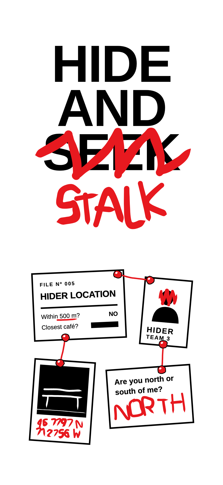
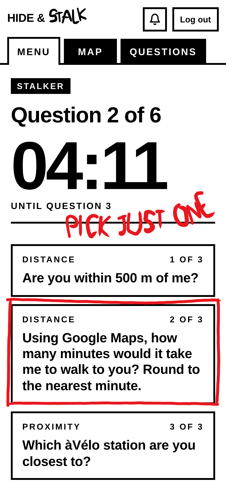
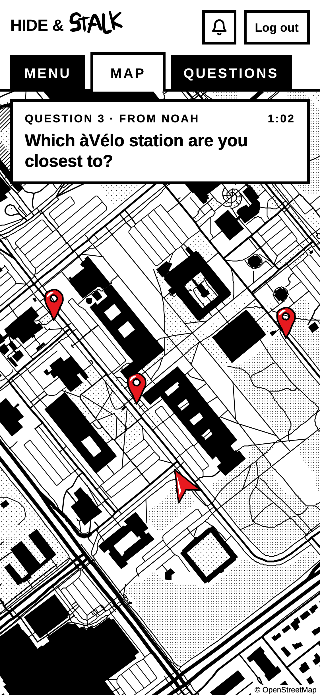

Un cache-cache sur tout le campus, environ 2 km², pour le Club d'intelligence artificielle. Dans chaque équipe, une personne se cache; les autres la cherchent en lui posant des questions dans l'app, qui resserre la carte à chaque réponse. 10 minutes pour se cacher, 30 pour trouver.

  

L'idée vient de Jet Lag: The Game[^1]. J'ai conçu le jeu : les règles, les questions, l'équilibre. Félix Larrivée a codé la première version de l'app; après deux parties d'essai en septembre, je l'ai repensée avec Claude Code.

Une partie du début à la fin, en anglais comme l'app : [la démo](https://ulyssegagne.github.io/hide-and-stalk/how-to-play/).

[^1]: Une série YouTube de Wendover Productions.
